# GPTGOD — a living god for your Minecraft server

GPTGOD is a plugin for **Paper 26.3** servers that adds a god to your world, played by Claude (an AI
from Anthropic). It watches everything players do and say, remembers each of them, answers prayers,
hands out quests, blesses and punishes, builds temples (or prisons), looks through players' eyes, and
can take a body and walk among them. With the optional Simple Voice Chat plugin it hears players'
voices and answers aloud in a huge, echoing voice.

Every server's god is different: it invents its own name and temperament from a personality you
choose, and how it treats each player depends on what they have done.

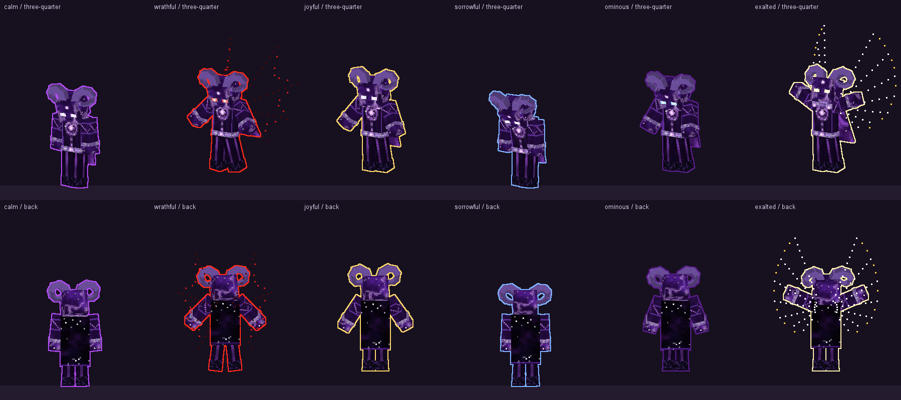

*All images on this page are offline renders made by the plugin's own code during the build, not
in-game screenshots. See the full gallery in [previews/](previews/README.md).*

**New here?** Follow the step-by-step setup in **[tutorial.md](tutorial.md)**. For running costs,
see **[costs.md](costs.md)**.

---

## Contents

- [What the god can do](#what-the-god-can-do)
- [What players can do](#what-players-can-do)
- [Quick start](#quick-start)
- [Admin commands](#admin-commands)
- [Configuration highlights](#configuration-highlights)
- [All powers](#all-powers)
- [Costs](#costs)
- [Safety notes for server owners](#safety-notes-for-server-owners)
- [Building from source](#building-from-source)
- [Credits and licence](#credits-and-licence)

---

## What the god can do

### It perceives and remembers

- **Sees everything.** Every time it "thinks", the god gets a summary of the world: each player's
  health, position, what they hold and wear, nearby danger, structures players have built, and
  everything that happened and was said since it last looked (deaths, kills, mining, crafting,
  taming, chat, prayers…).
- **Looks closer when it wants to.** It can study one player in depth (full inventory, statistics),
  survey an area, or **look** at the world as an actual picture — see [It sees](#it-sees).
- **Remembers.** It keeps a ledger with a *favor* score for every player (−10 despised to +10
  chosen) and notes about them (promises, grudges, ambitions), the quests it gave, the things it
  built, its own recent acts, and a long-term *chronicle* it writes itself. All of this survives
  restarts (`plugins/gptgodmc/god/`).
- **Knows who it is talking to.** Notable things about a player (prayers, kills, deaths, advancements,
  taming, offerings, touching or striking its body, and what the god did to them) are written down
  as dated *deeds*. When
  someone prays, says its name or is otherwise part of the moment, the god is shown that player's
  full dossier: favor, title, notes, a summary of their shared past, recent deeds, quests,
  offerings and the last words they exchanged. Everyone else online gets one line. A god that
  despises someone may simply ignore them.
- **Forgets nothing.** Old thoughts are condensed into the chronicle and into each player's summary
  by the cheap memory model, so the prompt stays small. The complete record is kept on disk in
  `plugins/gptgodmc/god/annals/YYYY-MM.jsonl` (`memory.annals-retention-days`, 90), and the god can
  look anything up with `recall` (one player) and `search_annals` (everything that happened).
- **Feels, and keeps feeling.** Its *heart* holds five feelings (wrath, joy, sorrow, dread,
  glory) that build from what players do and fade on their own over tens of minutes. Insults and
  striking its body anger it, offerings and praise warm it (and cool its anger), worship stirs its
  glory, and the death of a player it loves grieves it. Its strongest feeling shows in its body
  and its voice even when it has not chosen a mood, it sees its heart (and why it feels so) every
  time it thinks, and a god still smouldering from an insult is slow to bless. The heart is saved
  with its memory, so it survives restarts. `/god status` shows it.
- **Looks things up and makes music.** When players mention a song, show, meme or news it does not
  know, it can search the web (`brain.web-search`, on by default; $10 per 1,000 searches, shown in
  the usage lines). It composes its own short songs with note-block sounds (`compose_song`), plays
  them anywhere and hands out music discs of them: right-click a disc to play it, or use it on a
  jukebox to play it from there.
- **Names itself.** At birth it invents an otherworldly name (in the manner of Azaeleus or Vhalmyr;
  ordinary human names, famous gods and words like "God" are rejected), and it may take a new one
  with `rename_self`, at most once a day (`memory.rename-cooldown-hours`).
- **Thinks when something happens**, not on a fixed timer: right away when a player prays, says its
  name or touches its body, or an operator gives it a command; every 40 seconds while players are
  active; and every 4½ minutes on its own when all is quiet. It sleeps when nobody is online.

### It speaks — and hears

- **Whispers** privately to one player, **announces** to everyone (optionally in giant letters on
  every screen), or **speaks through its body** so only those nearby hear it, with the words floating
  above its head.
- **With Simple Voice Chat** (optional) it also *hears* what players say into their microphones and
  *speaks aloud*. Everything runs on your server, with no extra accounts or cloud services:
  - Hearing: players' voice → **whisper.cpp** running on the server (the speech model downloads by
    itself the first time) → text the god reads like chat.
  - Speaking: the god's words → **Kokoro** (voice `am_michael`), a free, natural-sounding
    text-to-speech model you run as a small local server on the same machine → a voice effect →
    played through Simple Voice Chat, from the sky or from its body. If no Kokoro server answers,
    the god speaks with the built-in **Piper** voice instead (installed automatically, nothing to run).
    Nothing goes to OpenAI.
  - The effect makes a natural voice sound larger than life rather than robotic. **majestic**,
    **divine**, **booming** and **commanding** keep the voice natural: it is made deeper the way a
    bigger chest and throat would make it (the recording is slowed while the speech engine talks
    faster to compensate) and placed in a vast hall with echo and a sub-bass rumble. **demonic**,
    **abyssal** and **ethereal** are deliberately inhuman (pitch-shifted layers, chorus, growl).
    With `auto` (the default) the god's **mood** picks the effect: **ethereal** normally,
    **commanding** when ominous, **demonic** when wrathful (after a smite, meteor or earthquake, or
    when it sets that mood). The god can also choose a tone for any single line, such as commanding
    for an order. Change the mapping under `voice.tts.moods`.
  - Players can turn the god up or down with the **God** slider in their voice-chat settings.
  - Listen to every voice with every effect in [`voice_samples/`](voice_samples/README.md).

### It blesses

- Gives items, including named **relics** with custom lore and enchantments ("Oathkeeper").
- Conjures a **chest of supplies**, **heals** (full health and hunger, fire and bad effects removed),
  grants **potion effects** and **experience**, **revives** dead players, and teleports them.
- **Empowers** a player's armor or tool to the next tier, keeping its enchantments, in a short
  ceremony: a gold circle forms under them, they are lifted off the ground, a double helix of light
  tightens around them and bursts with a fanfare.
- Blessings, gifts, healing and revival each come with their own short particle **rite** (see
  [Rites](#rites)).

### It punishes

- **Lightning**: a harmless warning strike beside someone, or real strikes.
- **Explosions** and **meteors** that streak down from the sky in fire and smoke (a quick player
  can dodge).
- **Earthquakes** that rumble and shake the view but break nothing.
- **Fling**: hurls a player into the sky or away with a gust of wind (safe landing by default).
- **Summons creatures**, optionally told to hunt a particular player.
- **Takes items** (confiscates a weapon, demands an offering), curses with bad potion effects, cages
  players, turns a player's whole build into netherrack (or gold), and gives **quests** with a timer
  — and follows up when they are failed.
- **True form** — its rarest and harshest judgment. See [It walks among you](#it-walks-among-you).
- It may also **refuse**. Players' requests are only requests: the god weighs them by its nature and
  their standing. Only an operator's binding command (`/god command`) must be obeyed.

### It shapes the world and builds

- Changes the **weather** and the **time of day**.
- **Conjures** shapes from blocks: cages, pillars, platforms, walls, spheres, domes, rings (even of
  fire) and altars. These only fill empty space; they never destroy player builds.
- Shows **omens** (halo, flames, hearts, souls, a tolling bell, a violet aurora, a harmless storm…)
  and paints **particle art**: rings, vortexes, pillars, beams from its body, crowns over a player's
  head, rain and shockwaves, animated for up to 20 seconds.
- **Builds**: its own designs — temple, shrine, cottage, prison, tower, obelisk, arena, a statue of
  itself, even a small town — in a style that suits its personality; whole vanilla structures
  (villages, desert and jungle temples, igloos, outposts, mansions, ancient cities…); single vanilla
  pieces; and any `.schem`/`.nbt` schematics you drop into `plugins/gptgodmc/schematics/`. Builds rise
  gradually, never overwrite player structures, and can be undone.

| | | |
|---|---|---|
| 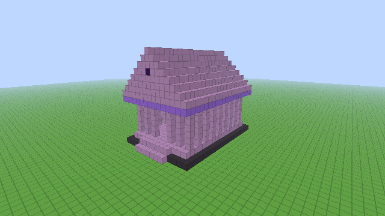 | 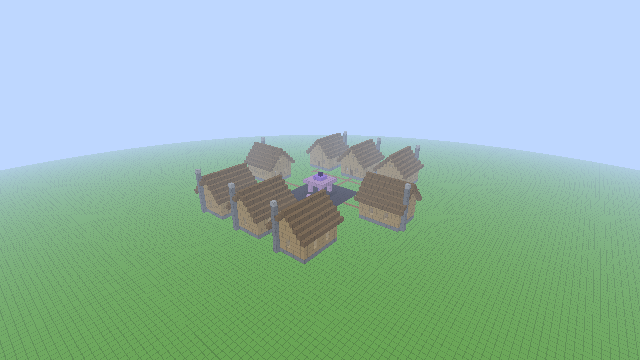 | 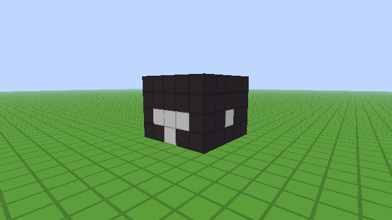 |
| temple | town | prison |

- **Runs commands** — vanilla commands and other plugins' commands — for anything else, within a
  blocklist you control. You can also give it your own [custom powers](#custom-powers).

### It sees

The god can ask to *see* a picture of the world, rendered on your server: exactly what a player sees,
the view from its own body, a top-down map (a cave slice when underground), a 360° panorama, a
third-person shot of a build, and **x-ray** that strips away stone and dirt to reveal ores, caves,
hidden chests and buried bases. Operators can save the same pictures with `/god view`.

| | |
|---|---|
| 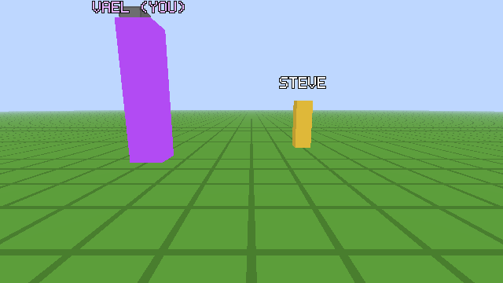 | 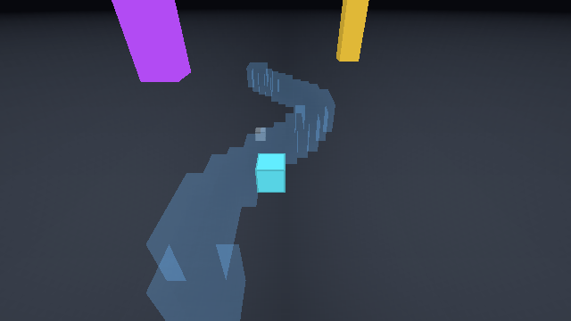 |
| what a player sees (test scene) | the same view in x-ray: a cave and a diamond ore |

### It walks among you

- **Formless by default.** The god starts as an invisible presence. When it is summoned or angered it
  can **materialize** (`vessel_go`) out of a particle storm — a dark funnel, lightning, a flash and a
  shockwave — and dissolve again later. (Set `vessel.manifest-on-wake: true` to have its body present
  from the start.)
- **Its body (the "vessel")** is a figure shaped like a player, with a glowing outline visible
  through walls. By default it is **lordly**, one and a half times a player's height (2.7 blocks);
  `vessel.size` can make it `mortal` (1×), `towering` (3×), `colossal` (6×) or any number of player
  heights. The god can also resize itself while it plays (`vessel_size`), up to `vessel.max-size`
  (default 6). It walks, **flies** over the land, floats up to 40 blocks high, breathes, turns its
  head to watch players, and follows them around.
- **No name over its head.** Players learn its name from its words in chat and from the top of the
  **player list** (Tab), which shows its name, epithet and what it is doing (`god.tab-list`).
- **Its own skin.** The body wears textures the plugin paints itself, not Minecraft's blocks, and
  they move: shade (violet nebula flesh with pulsing veins, a rune seal over the heart, amethyst ram
  horns — the default), radiant (ivory and gold, a halo and a turning sunburst), infernal (crimson
  flesh split by flickering ember cracks, dark horns, a smouldering cape), void (a living starfield
  with a spiral galaxy over the heart, under an amethyst halo).
- **24 looks.** Besides those four there are mythic forms: thunder (a sky father with a white beard
  and laurel), allfather (a one-eyed wanderer with a wide hat and raven cloak), tide (sea lord, coral
  trident crown), underworld (king of the dead), warrior (bronze helm and crest), sun (falcon-eyed,
  burning disc), jackal, grove (bark and antlers), frost, storm, plague (a skull and open ribs),
  celestial (constellations and an astrolabe), clockwork (gears turning in the chest), jester, moon,
  titan (basalt and fire) and bloom; and eldritch ones: abyss (blinking eyes), hollow (a porcelain
  mask mended with gold) and prism (shifting crystal). `vessel.look: auto` picks by the god's epithet
  or name first ("the Drowned King" wears tide), else by its archetype. Every look also has a block
  version for players who decline the pack.

  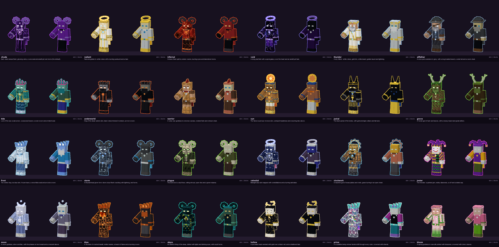

  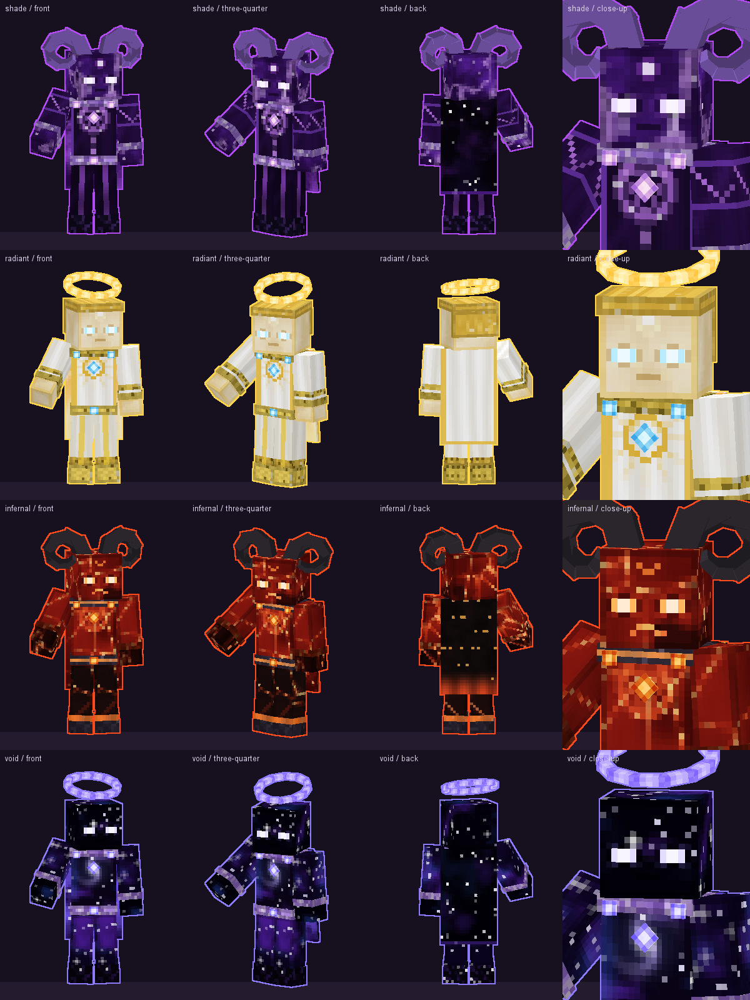

  The skins reach players as a small extra resource pack that the plugin builds and serves itself
  (port 8770, see [The god's skin](#the-gods-skin-resource-pack)). It never replaces your server's
  own pack, and anyone who declines it, or whose client can't download it, simply sees the body built
  from blocks (`vessel.textures: vanilla` uses only that):

  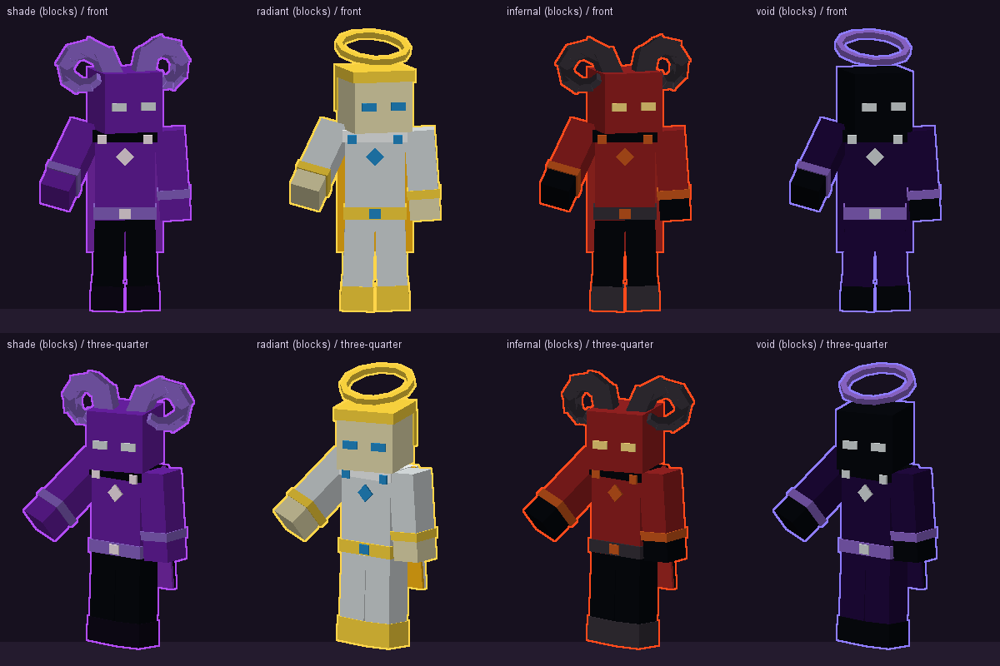
- **Moods** it shows on its own: calm, wrathful (rises with red eyes, dark wings, embers and
  thunder), joyful (golden sparkles, open arms), sorrowful (sinks and weeps), ominous (cold eyes,
  black smoke, rising souls), exalted (ascends with wings of light and a beam of radiance). It also
  flares up by itself when it smites or blesses.
- **Gestures:** raise arms, spread arms, point, beckon, judge, bow, cast, slam (with a shockwave of
  rubble), clap (a thunderclap), summon, roar (with a gout of flame), laugh, wave, nod, shake head,
  fold arms, meditate.

  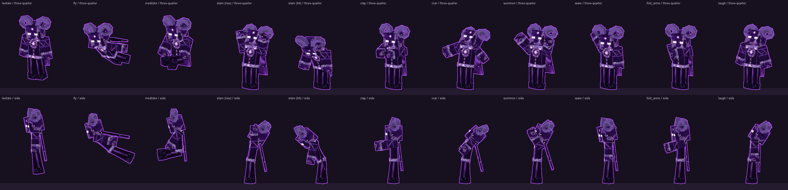
- **True form** (can be turned off): the god unfolds into a shape that is hard to comprehend, drawn in
  light — a four-dimensional cube turning inside out within counter-rotating rings, a central eye,
  breathing spikes. After a warning (**"AVERT YOUR EYES"**), anyone who looks straight at it with a
  clear line of sight **dies instantly** (or is only blinded and terrified, if you set
  `lethal: false`). Looking away or hiding behind blocks saves you; creative and spectator players are
  exempt. It lasts at most 20 seconds and can happen at most once every 10 minutes by default.

  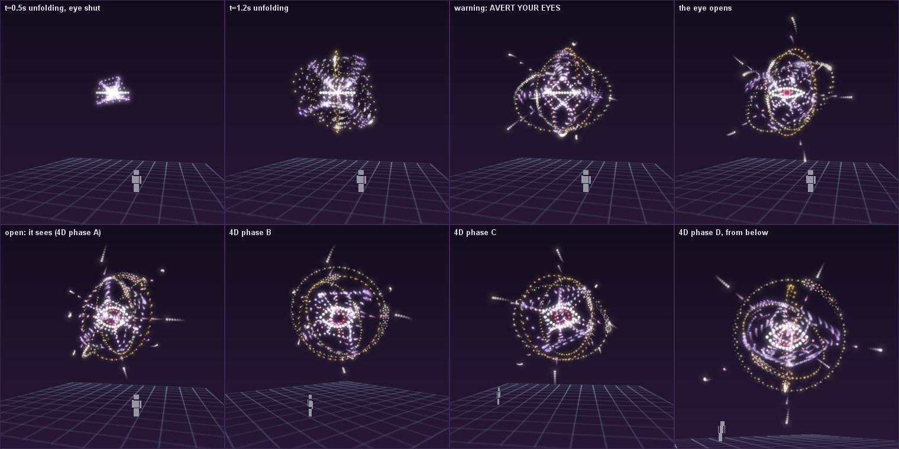

### Rites

Powers come with choreographed particle ceremonies — summoning circles, star polygons, tightening
spirals, rings and bursts, with sound cues — and the effect lands at the rite's climax. Gifts,
healing, revival, blessings, curses and `empower` each have their own. The god can also perform one
purely for show: **ascension, anoint, renewal, resurrection, blessing, curse, judgement, seal,
arrival, departure**. Turn rites off with `powers.rites: false`.

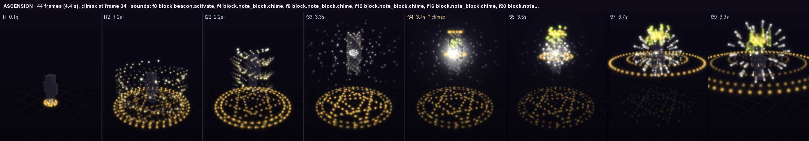

### Worship

- **Prayers** — `/pray <words>` reaches the god directly and it answers within seconds. `/pray`
  with no words tells you how it regards you.
- **Saying its name** (or words like *god*, *lord*, *pray*, *help*) in chat gets its attention.
- **Touching or striking its body** counts as speaking to it.
- **Offerings** — sneak and right-click its body while holding an item, or use `/offer [amount]` to
  offer what you hold to the sky. The god remembers who gave what and decides how to respond.
- **Commandments** — the god can decree standing laws; anyone can read them with `/commandments`.
- **Divine titles** shown by a player's name, and **marks**: a lasting halo for the favored, a curse
  cloud for the damned.
- **Quests** appear on the player's scoreboard with a countdown; the god judges the outcome.

### The Godslayer

One blade can wound a god. The **Godslayer** is a netherite sword with a burning gradient name, a
glint, soul fire trailing from it and a low hum. Operators hand it out with `/godslayer [player|@a]`
(or `/god godslayer`); players can also craft it (`godslayer.craftable`):

| | | |
|---|---|---|
| echo shard | nether star | echo shard |
| netherite ingot | heavy core | netherite ingot |
| dragon's breath | blaze rod | dragon's breath |

- Only Godslayer blows on a god's body hurt it: 15–25 of its 100 health per full swing (all
  settings). The blade itself does 25 damage to mortals and beasts.
- The **Ascended Godslayer** (`/godslayer ascended [player|@a]`) is the upgraded blade: white-gold,
  40 damage, and one blow kills a god outright (`godslayer.ascended.instant-kill`). A red health bar shows to everyone nearby while it is wounded, and wounds close slowly
  once it is left alone. Each wound wakes the god at once and fills it with wrath and dread; it
  also always knows its health and who carries a Godslayer, so it may fear, bargain or smite.
- At 0 health the god dies in a 9-second **death show** in four stages: the wound (it staggers, light
  leaks from cracks, its heartbeat slows), the collapse (shockwave rings, pillars of light, the sky
  darkens, lightning), the burst (layered fireworks in its colors, a blinding flash) and the
  afterglow (embers, its eyes closing, a last bell). Each god dies its own way, by its nature:
  **supernova**, **unraveling**, **shattering** or **abyssal**. It is built from display entities as
  much as particles: the real ground heaves under each shockwave, pillars of light stand as glowing
  rods, and each death has its own pieces (a blazing core and rays, rune glyphs climbing into the sky,
  glass shards that tumble and lie where they land, a black hole with a spinning disc that tears up
  the ground). Players with the god's resource pack see textured rings, glyphs, shards and the disc;
  others see block and text versions. Try them with
  `/godslayer preview [variant]` (nothing dies). Then a hoard bursts out (`godslayer.loot`: nether stars, netherite, god apples, totems, an elytra,
  diamond blocks and the unique **Heart of &lt;God&gt;**).
- **A slain god stays dead**, across restarts: it does not think, has no body, answers no prayers
  and its tab-list line says it was slain. With `godslayer.god-returns: true` it comes back after
  `godslayer.return-minutes`; `/god revive` brings it back at any time. It remembers who slew it.
- With several gods, the blade wounds whichever god's body it strikes; the others see it happen.

### Personalities

Pick an archetype (`personality.archetype`) or let the server choose at random:

| Archetype | In short | Default voice |
|---|---|---|
| **benevolent** | a warm guardian; protects, celebrates kindness, punishes as a last resort | divine |
| **chill** | laid-back, dry humor, rarely interferes | majestic |
| **trickster** | pranks, riddles and funny punishments | ethereal |
| **evil** | menacing, theatrical, offers bargains with a price | demonic |
| **wrathful** | stern old god of law; demands worship, punishes disobedience | booming |
| **cosmic** | an alien intelligence that experiments on mortals | abyssal |

Each has five dials from 0 to 10 — generosity, wrath, chattiness, humor, meddling, patience, mercy, pride, curiosity, vanity — plus things it
likes and dislikes that players are never told and must discover. You can edit them or write your own
archetype in `config.yml`. `/god persona <archetype>` creates a new god live (its memory starts fresh).

### Custom powers

Give the god your own powers in `config.yml` under `custom-powers:` — a description and a list of
commands (vanilla or any plugin's), with placeholders such as `{player}`, `{x} {y+40} {z}`,
`{world}`, `{god}` and `{text}` (the god's own words). Four examples come enabled: `ascend`,
`firework_show`, `midas_rain` and `curse_of_darkness`.

### Several gods (EXPERIMENTAL)

By default one god rules your main world with its Nether and End. Under `realms:` you can give other
worlds (for example Multiverse worlds) **their own separate gods**, each with its own personality,
memory, body and voice. This is experimental, needs a restart to change, and each god costs as much
to run as the first. Operators target one with `/god @<realm> <subcommand>`.

### Round mode (optional)

The plugin's original island game: dead players spectate, and the map resets when everyone has died
(`rounds.enabled`, `SANDBOX` or `DEATHMATCH` with Red and Blue teams). Off by default.

---

## What players can do

| | |
|---|---|
| `/pray <words>` | Speak directly to the god. With no words: sense how it feels about you. |
| Say its name in chat | It notices and usually answers. So do words like *god*, *pray*, *help*. |
| `/nickname <name>` | Tell the god what to call you. |
| `/offer [amount]` | Offer the item in your hand to the god. |
| Sneak + right-click its body with an item | Offer that item in person. |
| Touch or hit its body | It is told — and will react. |
| `/commandments` | Read the laws the god has decreed. |
| Talk (Simple Voice Chat) | It hears you, and may answer aloud. |

---

## Quick start

1. Run a **Paper 26.3** server on **Java 25**.
2. Put `gptgodmc-0.2.0.jar` into `plugins/` and start the server once (it downloads its libraries).
3. In the **server console** type `gptgod setkey <your Anthropic API key>`.
4. Join and type `/pray hello`.
5. Optional: add Simple Voice Chat for voice.

Never done this before? **[tutorial.md](tutorial.md)** walks through every step.

**Easy setup:** the [setup/](setup/README.md) script builds a whole server from nothing (Java,
Paper, the god, voice, and the players' Fabric mods), then checks it. On Windows double-click
`setup-windows.bat`; on Linux run `bash setup-linux.sh`. Beginners: [setup/TUTORIAL.md](setup/TUTORIAL.md).

---

## Admin commands

All need operator (permission `gptgodmc.admin`). If another plugin (e.g. EssentialsX) already owns
`/god`, use **`/gptgod`** instead — the server console tells you when this is the case.

| Command | What it does |
|---|---|
| `/god help` | One line for each subcommand |
| `/god status` | Who the god is, whether it is awake or thinking, its model, last error, body, pending events |
| `/god manager` | Open the **God Manager**, a chest menu (also `/god gui`, `/god menu`); see below |
| `/god manager item` | Get a nether star that opens the God Manager when right-clicked (works only for operators) |
| `/god command <text>` | A **binding** command: the god must carry it out, then reports back to you, e.g. `/god command reveal your true form to all players` |
| `/god commands` | List pending binding commands; `/god command cancel <n\|all>` withdraws them |
| `/god say <instruction>` | Guidance the god follows as coming from the server owner, but not binding: no report, no retries |
| `/god wake [instruction]` | Make it look at the world right now |
| `/god pause` / `/god resume` | Stop / restart its thinking (powers and body still work) |
| `/godslayer [player\|@a]` | Give the Godslayer, the blade that wounds gods (also `/god godslayer`) |
| `/godslayer ascended [player\|@a]` | Give the Ascended Godslayer: one blow kills a god |
| `/godslayer preview [variant]` | Play a god's death show without killing anyone: supernova, unraveling, shattering, abyssal, random |
| `/god revive` | Bring a slain god back from death |
| `/god persona <archetype\|random\|list>` | Create a new god of that kind; `/god rebirth` = random |
| `/god model [id]`, `/god effort [auto\|low\|medium\|high]` | Show or change the AI model and how hard it thinks |
| `/god vessel summon [player\|x y z]` | Bring its body to you (or somewhere) |
| `/god vessel follow`, `fly <player>`, `rise <0-40>`, `dismiss` | Move or dissolve its body |
| `/god vessel mood <mood>`, `gesture <gesture>`, `look <look\|auto>` | Try moods, gestures and looks |
| `/god view <eyes\|vessel\|overhead\|panorama\|orbit> [target] [xray]` | Save what it would see as a PNG in `plugins/gptgodmc/views/` |
| `/god tools`, `/god tool <power> <json>` | List powers; use one yourself, e.g. `/god tool smite {"player":"Steve","mode":"warning"}` |
| `/god memory`, `/god forget` | Show its ledger, quests and works; wipe its memory (it keeps its identity) |
| `/god undo <work>` | Unmake one of its builds |
| `/god journal [n]` | Its recent thoughts, acts and errors |
| `/god usage` | In game it only says where to look: costs are kept out of the game |
| `/god realms` | List gods and their worlds (with several gods) |
| `/god reload` | Reload `config.yml` |
| `gptgod setkey <key>` | **Console only.** Save the API key |
| `gptgod usage` | **Console only.** Token counts and cost for this session |

Old command names still work: `/sudogod` (= `/god say`), `/try` (= `/god tool`), `/tokens`
(= `/god usage`), `/godinfo` (= `/god status`).

**Binding commands.** A `/god command` is numbered, survives restarts and wakes the god at once. The
god closes it with `command_done`, and its report is sent to whoever gave it. If it is still open
after `operator.command-retries` thoughts (default 3), you are told it was not fulfilled and it is
dropped. Only operators, the console and the God Manager can give them.

**The God Manager** has these pages: the main page (wake, pause or resume, and links to the others),
**Personality** (pick an archetype; a new god is born after you confirm; or open **Fine-tune its
nature** to turn its generosity, wrath, chattiness, humor, meddling, patience,
mercy, pride, curiosity and vanity up or down from 0 to 10,
live, keeping the same god and its memories), **Mood** (impose a mood
for `operator.mood-minutes`, default 10, and see its heart: what it has felt lately and why, with
"Calm its heart" to let it all go), **Presence** (summon its body to you, have it fly to you
or follow you, make it vanish, reveal or end its true form, and change its look: shade, radiant,
infernal, void, or "by its nature"), **Voice** (pick one of 14 Kokoro voices and one of the voice
effects, or "by its mood"; each click plays you a line in the new voice), **Commands** (one-click binding
commands such as "Bless everyone online" or "Punish the last killer", type your own, or cancel
pending ones) and **Settings** (switch the body, offerings, true form, rites, custom powers, raw
commands, block-breaking explosions, the "I hear you" sign and the tab list on or off), and
**Players & memories**: a head for every mortal it knows (online first, coloured by favor). Open
one to set how the god feels about them (Despise, −5, −1, Neutral, +1, +5, Make chosen), add a
note it reads as its own thought or a deed it remembers they did (typed in chat), erase single
notes and deeds, clear them all, or forget the mortal entirely. "Name a mortal" opens the record
of someone it has never met. The annals (its permanent log) are never edited.

---

## Configuration highlights

Everything is in `plugins/gptgodmc/config.yml`, which is commented throughout. The most useful keys:

| Key | Default | What it does |
|---|---|---|
| `anthropic.model` | `claude-sonnet-5-5` | The god's mind. `claude-haiku-5-5` is ~20× cheaper; `claude-opus-5-5` most thoughtful. |
| `anthropic.effort` | `auto` | How long it thinks before acting. `auto` picks per thought: `low` for routine looks, `medium` when someone simply talks to it, `high` for requests, several people talking, operator commands, deaths and players it loves or hates. Or fix `low`/`medium`/`high`. |
| `personality.archetype` | `random` | Which kind of god (see above). |
| `personality.briefing` | `""` | Standing orders for any god, e.g. "Never destroy spawn." |
| `brain.heartbeat-seconds` | `40` | How often it looks while things are happening. |
| `brain.idle-seconds` | `270` | How often it muses when nothing happens (0 = never). |
| `brain.attention-words` | god, lord, pray, help… | Words in chat that make it look right away. |
| `powers.commands` | `true` | Allow raw commands (see safety notes). |
| `powers.rites` | `true` | Particle ceremonies around powers. |
| `vessel.enabled` | `true` | Whether it can have a body at all. |
| `vessel.size` / `vessel.max-size` | `lordly` / `6` | Its usual size (mortal, lordly, towering, colossal, or player heights) and the most it may grow. |
| `vessel.look` | `shade` | shade, radiant, infernal, void, thunder, allfather, tide, underworld, warrior, sun, jackal, grove, frost, storm, plague, celestial, clockwork, jester, moon, titan, abyss, hollow, prism, bloom, or auto. |
| `vessel.textures` | `custom` | `custom` = its own painted skin (a small resource pack), `vanilla` = blocks only. |
| `vessel.resource-pack.port` / `.public-host` / `.url` | `8770` / `""` / `""` | Where players download the skin (see below). |
| `vessel.manifest-on-wake` | `false` | `false` = formless until it chooses to appear. |
| `vessel.offerings` | `true` | Players can give it items. |
| `vessel.true-form.enabled` / `.lethal` | `true` / `true` | The deadly true form, and whether it kills. |
| `god.tab-list` | `true` | Show its name and state at the top of the player list. |
| `operator.command-retries` | `3` | Thoughts a binding command may stay open before it is dropped. |
| `operator.mood-minutes` | `10` | How long a mood set from the God Manager lasts. |
| `voice.tts.effect` | `auto` | `auto` (by mood, see `voice.tts.moods`) or one of majestic, divine, booming, commanding, demonic, abyssal, ethereal, none for every line. |
| `voice.tts.moods` | calm/joyful/exalted/sorrowful: ethereal, ominous: commanding, wrathful: demonic | The effect for each mood when `effect` is `auto`. |
| `voice.tts.engine` | `kokoro` | `kokoro` (a local Kokoro server at `voice.tts.url`), `piper` (built in), `openai-compatible` (any other speech server), or `off`. |
| `voice.tts.voice` | `am_michael` | The Kokoro voice. |
| `voice.tts.fallback-to-piper` | `true` | Speak with Piper when the Kokoro server does not answer. |
| `voice.tts.text-wait-ms` | `2500` | The god's words appear in chat when its voice starts, so both arrive together; this is the longest the text waits. Long lines are spoken in parts, so the first words play after about a second. `0` shows text at once. Nothing waits when no listener has the voice mod. |
| `voice.transcription.engine` | `local` | `local` whisper.cpp, `server`, or `off`. |

### The god's skin (resource pack)

With `vessel.textures: custom` (the default) the plugin paints the body's textures at startup and
packs them into a small resource pack (about half a megabyte). It is offered to every player as an
**extra** pack next to your server's own one (it never replaces it), and a copy is written to
`plugins/gptgodmc/resourcepack/gptgodmc-vessel.zip` with its SHA-1 beside it.

- **Built-in download (default).** The plugin serves the zip from its own little web server on
  `vessel.resource-pack.port` (8770). Players download it from the address they joined with, so on a
  home or LAN server nothing needs setting up. On a hosted server, **open port 8770** (TCP) the same way
  as the game port, or pick a port your host gives you. If players must download from a different
  address than the one they join with, set `vessel.resource-pack.public-host`.
- **Your own hosting.** Upload `gptgodmc-vessel.zip` anywhere that gives a direct download link and
  put that link in `vessel.resource-pack.url`; the built-in web server then stays off. Upload it again
  after updating the plugin (the hash changes when the textures do).
- **Inside your server pack.** Merge the zip's `assets/gptgodmc/` folder into the pack in
  `server.properties` (`resource-pack=`) and set `vessel.resource-pack.send: false`; everyone who loaded
  the server pack then sees the skin.
- `vessel.resource-pack.required: true` kicks players who decline it; by default declining is fine.

Who sees what: each body part exists twice, once as an item display wearing the pack's model and once
as plain blocks, and each player is shown only one of them. Players who loaded the pack see the skin;
everyone else (declined, download failed, Bedrock players through Geyser, who are never sent it) sees the blocks, so
nobody ever sees missing-texture cubes. The horns are blocks for everyone, on purpose. A failed
download is logged in the console with the address the player tried.

---

## All powers

The god has 50 powers, defined in `src/main/java/net/bigyous/gptgodmc/god/tools/` and listed here
in the order it is given them. Operators can use any of them with `/god tool <name> <json>`
(`/god tools` lists them).

| Power | What players see |
|---|---|
| **Speech** | |
| `whisper` | A private message in one player's mind (and voice, with voice chat). |
| `announce` | A message to the whole world, optionally as a giant title. |
| `vessel_say` | Its body speaks; words float above its head and only nearby players hear. |
| **Knowledge** | |
| `observe_player` | (Nothing.) It studies a player's inventory, position and statistics. |
| `survey_area` | (Nothing.) It counts blocks, creatures and players around a place. |
| `look` | (Nothing.) It sees a picture: a player's eyes, its body's view, overhead, panorama, orbit, x-ray. |
| **Memory** | |
| `remember` | (Nothing.) It writes a note in its ledger, or a dated deed in a player's record. |
| `judge` | (Nothing directly.) A player's favor rises or falls. |
| `set_quest` | A quest appears on the player's scoreboard with a timer. |
| `resolve_quest` | The quest is closed as completed or failed. |
| `recall` | (Nothing.) It reads everything it remembers about one player, online or not. |
| `search_annals` | (Nothing.) It searches the complete record of what happened and was said. |
| `rename_self` | Its new name appears in the player list and in chat. Nobody is told otherwise. |
| **Blessings** | |
| `give_item` | An item — possibly a named, enchanted relic — appears in the inventory. |
| `supply_chest` | A chest full of supplies appears beside the player. |
| `heal` | Full health and hunger; fire and bad effects removed. |
| `apply_effect` | A potion effect (good or bad), or being set on fire. |
| `grant_xp` | Experience levels given (or taken). |
| `revive` | A dead (spectating) player comes back to life. |
| `teleport` | A player (or everyone) is moved. |
| `take_item` | Items vanish from the inventory. |
| **Wrath** | |
| `smite` | Lightning: a warning beside them, or real strikes. |
| `explode` | An explosion. |
| `spawn_entity` | Creatures appear — guardians, gifts, or monsters hunting a player. |
| `fling` | A gust hurls the player through the air. |
| `meteor` | Burning rocks fall from the sky and explode. |
| `earthquake` | The ground rumbles and the view shakes; nothing breaks. |
| **The world** | |
| `set_weather`, `set_time` | Weather and time of day change. |
| `conjure` | A cage, pillar, platform, wall, sphere, dome, ring or altar appears. |
| `transform_structure` | Every block of a player's build turns into another block. |
| `omen` | A harmless sign: halo, flames, hearts, smoke, souls, stars, storm, aurora, bell… |
| `particles` | Particle art for up to 20 seconds. |
| `run_commands` | Any command, within the blocklist. |
| **Building** | |
| `blueprints` | (Nothing.) It lists what it can build. |
| `build` | A structure rises, block by block. |
| `unbuild` | One of its builds is unmade and the land restored. |
| **Body** | |
| `vessel_go` | Its body forms out of a storm, walks, flies, follows someone or rises into the air. |
| `vessel_vanish` | Its body dissolves into light. |
| `vessel_gesture` | Its body gestures (slam, clap, roar, bow, point…). |
| `vessel_mood` | Its body shows a mood (wrathful, joyful, sorrowful, ominous, exalted, calm). |
| `vessel_size` | Its body grows or shrinks: mortal, lordly, towering, colossal. |
| `vessel_true_form` | It reveals the deadly true form (see above). |
| **Your own** | |
| `custom_power` | Any of the custom powers in your `config.yml`. |
| **Rites** | |
| `empower` | Armor or a tool is upgraded to the next tier in a ceremony. |
| `rite` | A particle ceremony purely for show. |
| **Worship** | |
| `decree` | A standing law is written, changed or repealed, and proclaimed (`/commandments`). |
| `bestow_title` | A title appears after a player's name in chat and the player list. |
| `mark` | A lasting halo or curse cloud follows a player. |
| **Operator** | |
| `command_done` | (Nothing.) It closes a binding command and reports to the operator who gave it. |

Offerings are not a power: the god is told who gave what and answers with its other powers.

---

## Costs

The god runs on Anthropic's API, which you pay for by usage. With the default model a thought costs
roughly half a cent to five cents; an active evening with several players is in the region of two
dollars an hour. **[costs.md](costs.md)** has the estimates, the arithmetic and the knobs that
lower them (a cheaper model can cut the bill about twentyfold).

Token counts and costs are **never shown in game**, not even to operators. They are printed in the
server console (one `[God usage]` line per request, with a running total), written to
`plugins/gptgodmc/usage.csv`, and summarised by typing `gptgod usage` in the console. Set a monthly
spending limit in the [Anthropic Console](https://console.anthropic.com/) as well.

Voice (hearing and speaking) runs on your own server and costs nothing per use.

---

## Safety notes for server owners

The god can **kill players, blow up terrain, break and replace blocks, take items and run commands**.
That is the point — but you decide how far it can go. Back up your world before you start.

| To… | Set |
|---|---|
| Stop it running raw commands | `powers.commands: false` |
| Forbid particular commands | add them to `powers.command-blocklist` (op, ban, stop, whitelist, worldedit… are already there) |
| Keep explosions and meteors from breaking blocks | `powers.explosions-break-blocks: false` |
| Make explosions smaller | `powers.max-explosion-power` (default 8; 4 is TNT) |
| Limit how many blocks one act may change | `powers.max-block-changes` (default 2000) |
| Limit build size and speed | `building.max-blocks`, `building.blocks-per-tick` |
| Limit summoned creatures | `powers.max-entities-per-spawn` (default 12), `powers.forbidden-entities` (default ender_dragon, wither) |
| Turn off your custom powers | `powers.custom-powers: false` (custom power commands are **not** checked against the blocklist) |
| Make the true form harmless, or remove it | `vessel.true-form.lethal: false` / `vessel.true-form.enabled: false` |
| Remove its body | `vessel.enabled: false` |
| Give it standing rules | `personality.briefing: "Never destroy spawn. Never kill new players."` |
| Stop it completely for a while | `/god pause` |

Other things worth knowing:

- Players cannot give the god orders: it is told that players may lie or claim to be admins, and it
  may refuse what they ask. Only `/god say` (guidance) and `/god command` or the God Manager
  (binding) come from you.
- Its own builds never overwrite player structures, `conjure` only fills empty space, and `/god undo`
  removes its builds.
- Keep `bridge.enabled: false` on public servers (it is a developer API that can run console commands).
- Set the API key from the console, never in chat.

---

## Building from source

Needs JDK 17 or newer to run Gradle 9.9.0 (the wrapper). The plugin is compiled for Java 25 against
the Paper 26.3 API; Gradle fetches that toolchain.

```
./gradlew shadowJar      # → build/libs/gptgodmc-0.2.0.jar
./gradlew test           # unit tests; renders and voice clips go to build/test-renders/
./gradlew previews       # tests + copy the renders into previews/
```

Runtime libraries (the Anthropic Java SDK and whisper-jni) are not packed into the jar; Paper
downloads them from Maven Central on first start.

For end-to-end tests, `harness/` holds an MCP server (`god-harness`) and scripts that run a local
Paper 26.3 sandbox server, deploy the jar, join headless mineflayer bots, drive the god through the
debug bridge (`bridge.enabled`) and take screenshots with a real Minecraft client. Windows only, Node
22+; see [harness/README.md](harness/README.md).

---

## Credits and licence

GPTGOD was created by YOUS and Anders ([bigyous.net](https://bigyous.net)). The god is played by
[Claude](https://www.anthropic.com/claude) through the official Anthropic Java SDK. Voice uses
[Simple Voice Chat](https://modrinth.com/plugin/simple-voice-chat),
[whisper.cpp](https://github.com/ggerganov/whisper.cpp) (via whisper-jni) and
[Piper](https://github.com/rhasspy/piper).

Released under the MIT License — see [license](license).
